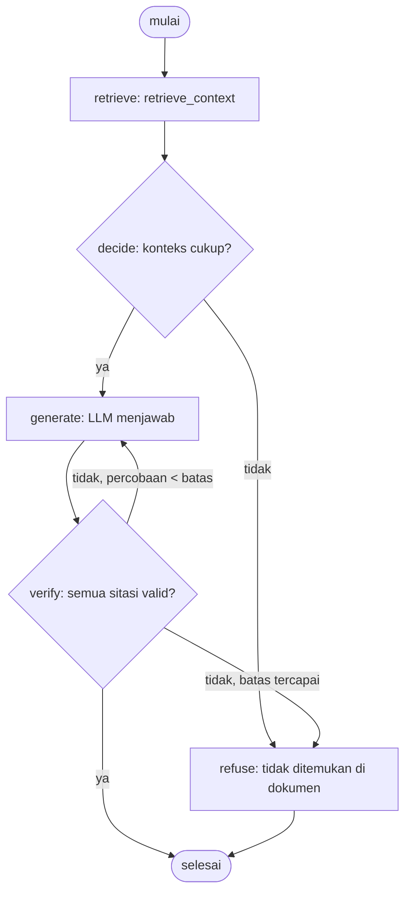

# SYSTEM_ANALYSIS.md

> Dokumen ini adalah referensi teknis lengkap untuk package `hybrid-rag`.
> Ditulis untuk dibaca oleh manusia maupun agent AI yang akan mengembangkan
> atau mengintegrasikan package ini. Verifikasi path dan nama fungsi ke kode
> langsung sebelum dipakai — jangan percayai dokumen ini buta.

---

## Daftar Isi

1. [Gambaran Umum](#1-gambaran-umum)
2. [Struktur Direktori](#2-struktur-direktori)
3. [Cara Kerja Tingkat Tinggi](#3-cara-kerja-tingkat-tinggi)
4. [Core — Fondasi Bersama](#4-core--fondasi-bersama)
5. [Providers — Hook dari Host](#5-providers--hook-dari-host)
6. [Config — Konfigurasi Lewat Env](#6-config--konfigurasi-lewat-env)
7. [WorkspacePool — LRU Cache Instance](#7-workspacepool--lru-cache-instance)
8. [Ingestion — Dokumen Masuk](#8-ingestion--dokumen-masuk)
9. [Retrieval — Konteks Keluar](#9-retrieval--konteks-keluar)
10. [Storage — Lapisan Penyimpanan](#10-storage--lapisan-penyimpanan)
11. [Tabel Database (DDL)](#11-tabel-database-ddl)
12. [Alur Data Lengkap](#12-alur-data-lengkap)
13. [Variabel Environment Lengkap](#13-variabel-environment-lengkap)
14. [Yang Ada vs Yang Dibutuhkan PRD](#14-yang-ada-vs-yang-dibutuhkan-prd)
15. [Catatan Penting untuk Agent](#15-catatan-penting-untuk-agent)

---

## 1. Gambaran Umum

`hybrid-rag` adalah Python package (bukan aplikasi) yang menyediakan:

- **Ingestion**: file → parse → chunk parent-child → ekstraksi knowledge graph → simpan ke PostgreSQL + Neo4j
- **Retrieval**: query → ekstrak keyword → hybrid search (vektor + BM25 + KG) → konteks bersitasi

Package ini **tidak punya** UI, CLI, parser LlamaParse, atau logika aplikasi.
Ia adalah *engine* yang dipakai oleh aplikasi host.

**Stack teknologi:**
- Penyimpanan: ParadeDB (PostgreSQL + pgvector + pg_search BM25)
- Graf (opsional): Neo4j
- Embedding: injeksi dari host via `providers.configure(get_embeddings=...)`
- LLM: injeksi dari host via `providers.configure(get_llm=...)`
- Parser bawaan: Amazon Textract (ada, tapi PRD mengganti ini dengan LlamaParse)
- Python ≥ 3.11, < 3.13

---

## 2. Struktur Direktori

```
hybrid-rag/
├── pyproject.toml                  # dependensi: asyncpg, langchain-core, neo4j, pgvector, pydantic, sastrawi, tiktoken, tenacity
└── src/hybrid_rag/
    ├── __init__.py                 # docstring paket, entry point
    ├── config.py                   # RagSettings (pydantic-settings, baca dari .env)
    ├── providers.py                # hook dari host: get_llm, get_embeddings, rerank, s3, progress
    ├── workspace_pool.py           # WorkspacePool: LRU cache instance per workspace
    │
    ├── core/
    │   ├── base.py                 # ABC: StorageNameSpace, BaseVectorStorage, BaseKVStorage, BaseGraphStorage, DocStatus
    │   ├── types.py                # Pydantic models: KnowledgeGraph, KnowledgeGraphNode/Edge, ExtractedEntity/Relationship
    │   ├── constants.py            # GRAPH_FIELD_SEP, FULL_DOCS_FORMAT_RAW, SOURCE_IDS_LIMIT_*
    │   ├── exceptions.py           # PipelineNotInitializedError, PipelineCancelledException, IndexFlushError
    │   ├── embedding.py            # build_embedding_func() — bungkus LangChain Embeddings ke EmbeddingFunc
    │   ├── chunk_schema.py         # normalize_chunk_heading/sidecar, format_parent_headings
    │   ├── namespace.py            # NameSpace enum, is_namespace()
    │   ├── concurrency.py          # limit_async_func_call, _cooperative_yield
    │   ├── llm_cache.py            # CACHE_KV, CACHE_MODE, CACHE_QUERYPARAM, cached_chain
    │   ├── prompts.py              # load_prompt, load_prompt_file (baca YAML prompt)
    │   └── utils.py                # Tokenizer, TiktokenTokenizer, EmbeddingFunc, compute_mdhash_id, dan banyak helper
    │
    ├── ingestion/
    │   ├── __init__.py             # lazy import: IngestionRAG, build_rag, parse_file, delete_document, dll.
    │   ├── rag.py                  # IngestionRAG (dataclass @final, gabungan 4 mixin)
    │   ├── factory.py              # build_rag(workspace) -> IngestionRAG; build_pipeline() context manager
    │   ├── pipeline.py             # parse_file() — context manager, file → content_list
    │   ├── insert.py               # _IngestionMixin: insert_content_list, _insert_text_content
    │   ├── worker.py               # _PipelineMixin: apipeline_enqueue_documents, apipeline_process_enqueue_documents
    │   ├── parse_stage.py          # parse_stored_document() — passthrough (konten sudah parsed)
    │   ├── utils.py                # enforce_chunk_token_limit_before_embedding, merge_source_ids, sanitize helpers
    │   ├── doc_status_fields.py    # helper baca/tulis field doc_status, dedup berdasarkan content_hash/file_basename
    │   ├── workspace.py            # workspace_pool (write): WorkspacePool[IngestionRAG]
    │   │
    │   ├── chunking/
    │   │   └── parent_child.py     # chunking_parent_child() — split parent 2500 char, child 310 char
    │   │
    │   ├── parser/
    │   │   ├── amazon_textract/    # Textract sync parser: reconstruct_content_list()
    │   │   ├── async_amazon_textract/ # Textract async: parse_document_to_json()
    │   │   └── office_to_pdf.py    # convert_office_to_pdf() via unoserver; SUPPORTED_EXTENSIONS
    │   │
    │   ├── knowledge_graph/
    │   │   ├── chain.py            # get_kg_chains() — LangChain chain ekstraksi per domain
    │   │   ├── extraction.py       # extract_entities(), merge_nodes_and_edges()
    │   │   ├── schema.py           # EntityExtractionOutput (Pydantic output schema)
    │   │   ├── merge_session.py    # session merge entitas/relasi yang sama
    │   │   ├── knowledge_graph.yaml # prompt ekstraksi default (domain Indonesia legal/regulasi)
    │   │   └── domains/            # prompt per domain custom (YAML)
    │   │
    │   ├── multimodal/
    │   │   ├── analyze.py          # _AnalyzeMixin: orkestrasi analisis image/table/equation
    │   │   ├── content.py          # separate_content(), format_table_body(), get_processor_for_type()
    │   │   ├── image_processor.py  # ImageModalProcessor
    │   │   ├── table_processor.py  # TableModalProcessor
    │   │   ├── equation_processor.py # EquationModalProcessor
    │   │   ├── generic_processor.py  # GenericModalProcessor
    │   │   ├── base_processor.py   # BaseProcessor ABC
    │   │   ├── vlm.py              # VLM chain untuk captioning
    │   │   └── multimodal.yaml     # prompt VLM
    │   │
    │   └── deletion/
    │       ├── deletion.py         # _DeletionMixin: hapus dokumen dari semua storage
    │       └── pipeline.py         # delete_document() — entry point publik
    │
    ├── retrieval/
    │   ├── __init__.py             # lazy import: RetrievalRAG, retrieve_context, QueryParam, dll.
    │   ├── rag.py                  # RetrievalRAG (dataclass @final, read-only)
    │   ├── factory.py              # build_rag(workspace) -> RetrievalRAG
    │   ├── pipeline.py             # retrieve_context(), retrieve_context_without_relations()
    │   ├── query.py                # kg_query(), extract_keywords_only(), _build_query_context()
    │   ├── search.py               # _perform_kg_search(), _get_vector_context(), _get_node_data(), _get_edge_data()
    │   ├── context.py              # _apply_token_truncation(), _merge_all_chunks(), _build_context_str()
    │   ├── rerank.py               # apply_rerank_if_enabled(), process_chunks_unified()
    │   ├── utils.py                # convert_to_user_format(), generate_reference_list_from_chunks(), pick_by_*
    │   ├── types.py                # QueryParam, QueryResult
    │   ├── context_template.py     # TEMPLATES — format teks konteks entitas/relasi/chunk
    │   ├── workspace.py            # workspace_pool (read): WorkspacePool[RetrievalRAG]
    │   └── keywords/
    │       ├── chain.py            # keywords_chain() — ekstrak high/low-level keywords dari query
    │       ├── schema.py           # KeywordsOutput (Pydantic)
    │       └── keywords.yaml       # prompt ekstraksi keyword
    │
    └── storage/
        ├── __init__.py
        ├── shared.py               # state process-wide: locks, namespace_data, default_workspace
        ├── neo4j.py                # Neo4JStorage — graph storage dengan isolasi per workspace
        ├── neo4j_driver.py         # get_neo4j_driver() — singleton driver Neo4j
        └── postgres/
            ├── __init__.py         # export PGDocStatusStorage, PGKVStorage, PGVectorStorage
            ├── connection.py       # PostgreSQLDB, ClientManager, asyncpg pool, retry, batching
            ├── sql.py              # TABLES (DDL), SQL_TEMPLATES, NAMESPACE_TABLE_MAP
            ├── vector.py           # PGVectorStorage — hybrid BM25+vektor, RRF fusion
            ├── kv.py               # PGKVStorage — KV store: full_docs, chunks, entities, relations, llm_cache
            ├── doc_status.py       # PGDocStatusStorage — status pipeline per dokumen
            └── bm25_text.py        # preprocess_indonesian_fast() — stopword Sastrawi untuk BM25
```

---

## 3. Cara Kerja Tingkat Tinggi

### Ingestion (dokumen masuk)

```
File (pdf/docx/pptx/md/txt/json)
    │
    ▼
parse_file()                     ← pipeline.py, context manager
    │  pdf/office → Textract (async) → content_list
    │  md/txt     → baca langsung   → content_list
    │  json       → load JSON       → content_list
    ▼
insert_content_list()            ← insert.py
    │  separate_content()  → text_content + multimodal_items + page_offsets
    │  _insert_text_content()
    │      apipeline_enqueue_documents()   ← worker.py
    │      apipeline_process_enqueue_documents()
    │          parse_stored_document()     ← parse_stage.py (passthrough)
    │          chunking_parent_child()     ← chunking/parent_child.py
    │          _analyze_multimodal()       ← multimodal/analyze.py (VLM)
    │          extract_entities()          ← knowledge_graph/extraction.py
    │          merge_nodes_and_edges()
    │          → flush ke PGVectorStorage (embedding + BM25)
    │          → flush ke PGKVStorage (full_docs, chunks, entities, relations)
    │          → flush ke Neo4JStorage (nodes + edges)
    │          → update PGDocStatusStorage
    ▼
Database (ParadeDB + Neo4j)
```

### Retrieval (konteks keluar)

```
query string
    │
    ▼
retrieve_context()               ← pipeline.py
    │  lease workspace_pool (read)
    │  rag.aretrieve(query, param)
    │      kg_query()            ← query.py
    │          extract_keywords_only()
    │              keywords_chain()  → high_level + low_level keywords
    │          _build_query_context()
    │              _perform_kg_search()    ← search.py
    │                  entity search (Neo4j + entity VDB)
    │                  relation search (Neo4j + relation VDB)
    │                  _get_vector_context() → hybrid BM25+vektor (PGVectorStorage)
    │              _apply_token_truncation() ← context.py
    │              _merge_all_chunks()
    │                  process_chunks_unified() ← rerank.py
    │              _build_context_str()
    ▼
RetrievalResult(context, image_paths, raw_data)
```

---

## 4. Core — Fondasi Bersama

### `core/base.py`

Abstract base classes yang diimplementasi oleh semua storage backend:

```python
class StorageNameSpace(ABC):
    namespace: str
    workspace: str
    global_config: dict[str, Any]
    
    async def initialize(): ...
    async def finalize(): ...
    async def index_done_callback(): ...   # flush semua pending writes
    async def drop_pending_index_ops(): ...  # buang buffer saat abort

class BaseVectorStorage(StorageNameSpace, ABC):
    embedding_func: EmbeddingFunc
    cosine_better_than_threshold: float = 0.2
    
    async def query(query, top_k, query_embedding=None): ...
    async def upsert(data: dict): ...

class BaseKVStorage(StorageNameSpace, ABC):
    async def get_by_id(id): ...
    async def get_by_ids(ids): ...
    async def upsert(data: dict): ...
    async def delete(ids): ...

class BaseGraphStorage(StorageNameSpace, ABC):
    async def upsert_node(node_id, node_data): ...
    async def upsert_edge(src, tgt, edge_data): ...
    async def get_node(node_id): ...
    async def get_edge(src, tgt): ...
    # ... dll.

class DocStatus(str, Enum):
    PENDING = "PENDING"
    PARSING = "PARSING"
    PROCESSING = "PROCESSING"
    ANALYZING = "ANALYZING"    # legacy, tidak ditulis lagi
    PROCESSED = "PROCESSED"
    FAILED = "FAILED"
    PARTIAL_PROCESSED = "PARTIAL_PROCESSED"
```

### `core/types.py`

```python
class ExtractedEntity(BaseModel):
    entity_name: str
    entity_type: str
    entity_description: str

class ExtractedRelationship(BaseModel):
    source_entity: str
    target_entity: str
    relationship_keywords: str
    relationship_description: str

class KnowledgeGraphNode(BaseModel):
    id: str
    labels: list[str]
    properties: dict[str, Any]

class KnowledgeGraphEdge(BaseModel):
    id: str
    type: Optional[str]
    source: str   # id node sumber
    target: str   # id node tujuan
    properties: dict[str, Any]

class KnowledgeGraph(BaseModel):
    nodes: list[KnowledgeGraphNode] = []
    edges: list[KnowledgeGraphEdge] = []
    is_truncated: bool = False
```

### `core/constants.py`

- `GRAPH_FIELD_SEP = "<SEP>"` — pemisah field di database graf. **Tidak boleh diubah setelah data masuk.**
- `FULL_DOCS_FORMAT_RAW = "raw"` — format dokumen yang masuk lewat `insert_content_list`
- `SOURCE_IDS_LIMIT_METHOD_KEEP = "KEEP"` / `SOURCE_IDS_LIMIT_METHOD_FIFO = "FIFO"`
- `DEFAULT_ENTITY_NAME_MAX_LENGTH = 256`
- `FILE_EXTRACTION_SUMMARY_PREFIX = "[File Extraction]"`

### `core/embedding.py`

```python
def build_embedding_func() -> EmbeddingFunc:
    """Bungkus LangChain Embeddings ke contract ndarray storage."""
    embeddings = providers.get_embeddings(
        settings.embedding_model,
        settings.embedding_binding_host,
        settings.embedding_binding_api_key,
    )
    async def embed(texts: list[str]) -> np.ndarray:
        return np.array(await embeddings.aembed_documents(texts), dtype=np.float32)
    return EmbeddingFunc(embedding_dim=settings.embedding_dim, ...)
```

### `core/chunk_schema.py`

- `normalize_chunk_heading(dp)` — normalisasi heading flat/nested ke `{"level", "heading", "parent_headings"}`
- `normalize_chunk_sidecar(dp)` — validasi sidecar multimodal (block/drawing/table/equation)
- `format_parent_headings(heading_dict)` — render breadcrumb `"A → B → C"`
- `_truncate_section_context(text, tokenizer, max_tokens)` — potong breadcrumb sesuai budget token

---

## 5. Providers — Hook dari Host

**File:** `providers.py`

Package tidak membangun klien model sendiri. Host memanggil `configure()` sekali sebelum instance dibangun:

```python
from hybrid_rag import providers

providers.configure(
    get_llm=my_get_llm,
    # Signature: (model_id, *, max_tokens, base_url, api_key, timeout, temperature) -> LangChain chat model
    
    get_embeddings=my_get_embeddings,
    # Signature: (model_id, base_url, api_key) -> LangChain Embeddings
    
    rerank=my_rerank,
    # Signature: (query, documents, top_n=...) -> [{"index", "relevance_score"}]
    # Opsional — None menonaktifkan reranking
    
    s3=my_s3,
    # Objek dengan: upload_figures_to_s3, upload_fileobj, delete_object, require_bucket
    # Dipakai untuk Textract dan crop gambar
    
    progress=my_progress,
    # Objek dengan: stage(), skip(), activity(), current_doc_id, current_workspace
    # Opsional — default _Silent() drops semua event
)
```

**Cara akses di dalam package:**

```python
from hybrid_rag import providers

providers.get_llm(model_id, ...)    # langsung panggil hook
providers.get_embeddings(...)
providers.rerank_func()             # kembalikan fungsi rerank atau None
providers.s3.upload_fileobj(...)    # via _Proxy — forward ke hook
providers.progress.stage("parse")   # via _Proxy
```

Jika hook belum di-`configure`, akses melempar `RuntimeError` dengan pesan jelas.

---

## 6. Config — Konfigurasi Lewat Env

**File:** `config.py`

Semua konfigurasi dibaca dari environment atau file `.env` via `pydantic-settings`.
Instance singleton: `from hybrid_rag.config import settings`.

### Kelompok Variabel

#### LLM
| Env var | Default | Keterangan |
|---|---|---|
| `LLM_BINDING_HOST` | None | Base URL LLM utama (wajib) |
| `LLM_BINDING_API_KEY` | None | API key LLM utama (wajib) |
| `LLM_MODEL` | `gpt-4o-mini` | Model LLM utama |
| `LLM_MAX_ASYNC` | 4 | Konkurensi panggilan LLM |
| `KEYWORD_LLM_*` | fallback ke LLM_* | LLM khusus ekstraksi keyword |
| `EXTRACT_LLM_*` | fallback ke LLM_* | LLM khusus ekstraksi entitas |
| `VLM_MODEL` | `mjai.kimi-k2.5` | Model VLM untuk captioning |
| `VLM_MAX_ASYNC` | 3 | Konkurensi VLM per dokumen |
| `VLM_TIMEOUT` | 120.0 | Timeout per panggilan VLM (detik) |
| `MAX_RETRIES` | 5 | Retry maksimum |
| `CONTEXTUALIZE_MODEL` | None (→ LLM_MODEL) | Model contextualize (v1: dimatikan) |

#### Embedding
| Env var | Default | Keterangan |
|---|---|---|
| `EMBEDDING_BINDING_HOST` | None | Base URL embedding (wajib) |
| `EMBEDDING_BINDING_API_KEY` | None | API key embedding (wajib) |
| `EMBEDDING_MODEL` | `mjai.titan-embed-text-v2:0` | Model embedding |
| `EMBEDDING_DIM` | 1024 | Dimensi vektor (harus cocok dengan tabel) |
| `EMBEDDING_TOKEN_LIMIT` | 8192 | Batas token per teks |
| `EMBEDDING_BATCH_NUM` | 1 | Ukuran batch embedding |
| `EMBEDDING_FUNC_MAX_ASYNC` | 8 | Konkurensi embedding |
| `EMBEDDING_TIMEOUT` | 60.0 | Timeout embedding (detik) |

> **PENTING:** Untuk PRD ini, set `EMBEDDING_MODEL=BAAI/bge-m3` dan `EMBEDDING_DIM=1024`.

#### Retrieval
| Env var | Default | Keterangan |
|---|---|---|
| `TOP_K` | 40 | Entitas/relasi yang diambil dari KG |
| `CHUNK_TOP_K` | 40 | Chunk yang disimpan setelah reranking |
| `PARENT_TOP_K` | 10 | Parent chunk saat return_parent=True |
| `COSINE_THRESHOLD` | 0.2 | Threshold similarity minimum |
| `HYBRID_SEARCH_CHUNK_CANDIDATES` | 30 | Pool kandidat sebelum RRF |
| `HYBRID_SEARCH_W_SEMANTIC` | 1.2 | Bobot arm vektor di RRF |
| `HYBRID_SEARCH_W_KEYWORD` | 0.8 | Bobot arm BM25 di RRF |
| `KG_CHUNK_PICK_METHOD` | `VECTOR` | Cara pilih chunk dari KG: VECTOR atau WEIGHT |

#### Chunking
| Env var | Default | Keterangan |
|---|---|---|
| `PARENT_CHUNK_SIZE` | 2500 | Ukuran parent chunk (karakter) |
| `PARENT_CHUNK_OVERLAP` | 200 | Overlap parent |
| `CHILD_CHUNK_SIZE` | 310 | Ukuran child chunk (karakter) |
| `CHILD_CHUNK_OVERLAP` | 50 | Overlap child |

#### Reranking
| Env var | Default | Keterangan |
|---|---|---|
| `RERANK_MODEL` | None | Model reranker (kosong = tidak rerank) |
| `RERANK_BINDING_HOST` | None | Base URL reranker |
| `RERANK_BY_DEFAULT` | True | Aktifkan rerank secara default |
| `MIN_RERANK_SCORE` | 0.0 | Score minimum setelah rerank |

> Untuk PRD v1: set `RERANK_MODEL=` (kosong) untuk mematikan reranking.

#### Knowledge Graph
| Env var | Default | Keterangan |
|---|---|---|
| `MAX_ENTITY_TOKENS` | 6000 | Budget token blok entitas |
| `MAX_RELATION_TOKENS` | 8000 | Budget token blok relasi |
| `MAX_GRAPH_NODES` | 1000 | Maksimum node dikembalikan |
| `MAX_EXTRACTION_ENTITIES` | 40 | Entitas per panggilan ekstraksi |
| `MAX_GLEANING` | 1 | Iterasi gleaning |
| `FORCE_LLM_SUMMARY_ON_MERGE` | 8 | Trigger summary LLM saat merge banyak deskripsi |

#### PostgreSQL
| Env var | Default | Keterangan |
|---|---|---|
| `POSTGRES_HOST` | `localhost` | Host PostgreSQL/ParadeDB |
| `POSTGRES_PORT` | 5432 | Port |
| `POSTGRES_DATABASE` | `postgres` | Nama database |
| `POSTGRES_USER` | `postgres` | User |
| `POSTGRES_PASSWORD` | `` | Password |
| `POSTGRES_SCHEMA` | `rag` | Schema PostgreSQL |
| `POSTGRES_MAX_CONNECTIONS` | 25 | Total koneksi pool |
| `POSTGRES_SSL_MODE` | `prefer` | Mode SSL |
| `POSTGRES_VECTOR_INDEX_TYPE` | `HNSW` | Tipe index vektor |
| `POSTGRES_HNSW_M` | 16 | Parameter HNSW m |
| `POSTGRES_HNSW_EF` | 256 | Parameter HNSW ef_construction |
| `RAG_SCHEMA_BOOTSTRAP` | False | Buat tabel + index saat pertama jalan |

#### Neo4j
| Env var | Default | Keterangan |
|---|---|---|
| `NEO4J_URI` | None | URI Neo4j (kosong = Neo4j dimatikan) |
| `NEO4J_USERNAME` | None | Username |
| `NEO4J_PASSWORD` | None | Password |
| `NEO4J_DATABASE` | None | Nama database |

> Untuk PRD: biarkan `NEO4J_URI` kosong agar Neo4j tidak dipakai.

#### Pipeline
| Env var | Default | Keterangan |
|---|---|---|
| `MAX_PARALLEL_INGESTION` | 40 | Dokumen diproses bersamaan (process-wide) |
| `ENABLE_LLM_CACHE` | True | Cache respons LLM |
| `MAX_WORKSPACES` | 70 | Ukuran LRU pool workspace |

#### AWS/Textract (tidak dipakai di PRD)
| Env var | Default | Keterangan |
|---|---|---|
| `TEXTRACT_ACCESS_KEY_ID` | None | AWS key untuk Textract |
| `TEXTRACT_SECRET_ACCESS_KEY` | None | |
| `TEXTRACT_REGION` | None | |
| `UNOSERVER_HOST` | `unoserver` | Host unoserver untuk konversi Office |
| `UNOSERVER_PORT` | 2003 | |

---

## 7. WorkspacePool — LRU Cache Instance

**File:** `workspace_pool.py`

```python
class WorkspacePool(Generic[T]):
    """LRU cache instance per workspace, dengan lease protection."""
    
    def __init__(self, build: Callable[[str], Awaitable[T]], max_workspaces: int): ...
    
    async def lease(self, workspace: str) -> AsyncContextManager[T]:
        """Pinjam instance workspace, dilindungi dari eviksi selama dipegang."""
    
    async def warm(self, workspace: str) -> None:
        """Pre-build dan cache instance workspace."""
    
    async def shutdown(self) -> None:
        """Finalize semua instance saat shutdown."""
```

**Cara kerja:**
- Instance dibangun satu kali per workspace (`_build(ws)`)
- LRU eviction: jika sudah melebihi `max_workspaces`, workspace paling lama tidak dipakai yang di-evict
- Instance yang sedang di-lease tidak bisa di-evict
- Build dikunci per workspace (`_build_locks`) sehingga request A untuk workspace B tidak memblokir request C untuk workspace D
- `finalize_storages()` dipanggil di background saat eviction

**Pool publik:**
- `hybrid_rag.ingestion.workspace_pool` — pool tulis (`IngestionRAG`)
- `hybrid_rag.retrieval.workspace_pool` — pool baca (`RetrievalRAG`)

---

## 8. Ingestion — Dokumen Masuk

### 8.1 Entry Points Publik

```python
from hybrid_rag.ingestion import parse_file, workspace_pool, delete_document

# Parse file → content_list
async with parse_file("dokumen.pdf") as content_list:
    async with workspace_pool.lease("docs") as rag:
        await rag.insert_content_list(
            content_list,
            file_path="dokumen.pdf",
            doc_id="sha256-...",         # opsional, digenerate dari konten jika tidak diberikan
            domain=None,                  # domain ekstraksi KG, None = default
            save_parent=True,             # simpan teks parent untuk return_parent
        )
```

### 8.2 `parse_file()` — File ke Content List

**File:** `ingestion/pipeline.py`

Context manager, bukan fungsi biasa. Alasan: direktori temp (figure crops) harus hidup sampai insert selesai.

**Format yang didukung:**

| Extension | Parser | Keterangan |
|---|---|---|
| `.pdf` | Amazon Textract | Async, upload ke S3 dahulu |
| `.docx`, `.pptx`, `.xlsx`, `.odt`, dll. | unoserver + Textract | Konversi ke PDF dahulu via unoserver |
| `.md`, `.txt`, `.markdown` | Baca langsung | Tidak butuh API key |
| `.json` | Load JSON | Konten harus sudah berupa content_list |

> **Catatan PRD:** Parser yang ada adalah Amazon Textract. PRD mensyaratkan LlamaParse. Parser baru harus diimplementasi di `ingestion/parser/` dan dipanggil dari `parse_file()`.

**Format content_list:**

```python
[
    {"type": "text", "text": "isi teks...", "page_idx": 0},
    {"type": "image", "img_path": "/abs/path/img.jpg", "image_caption": ["..."], "page_idx": 1},
    {"type": "table", "table_body": "| col | ... |", "table_caption": ["..."], "page_idx": 2},
    {"type": "equation", "latex": "E=mc^2", "text": "persamaan energi", "page_idx": 3},
]
```

### 8.3 `insert_content_list()` — Content List ke Storage

**File:** `ingestion/insert.py` → `_IngestionMixin`

Alur:
1. `separate_content()` → pisahkan text + multimodal + page_offsets
2. `_insert_text_content()` → enqueue + process pipeline

**Doc ID:** Jika tidak diberikan, digenerate dari SHA-256 konten via `compute_mdhash_id()`.
PRD mensyaratkan `doc_id = sha256(isi file)` — sebaiknya hitung di luar dan berikan eksplisit.

### 8.4 Worker Pipeline

**File:** `ingestion/worker.py` → `_PipelineMixin`

Proses per dokumen dalam pipeline batch:
1. `parse_stored_document()` — passthrough (konten sudah ada)
2. `chunking_parent_child()` — split parent 2500 char, lalu child 310 char
3. `_analyze_multimodal()` — caption image/table/equation via VLM (jika ada)
4. `extract_entities()` — ekstrak entitas + relasi via LLM
5. `merge_nodes_and_edges()` — merge ke KG yang ada
6. Flush ke storage (vektor + KV + Neo4j + doc_status)

**Konkurensi:** `MAX_PARALLEL_INGESTION` semaphore mengontrol berapa dokumen diproses bersamaan secara process-wide.

### 8.5 Chunking Parent-Child

**File:** `ingestion/chunking/parent_child.py`

```python
def chunking_parent_child(
    tokenizer: Tokenizer,
    content: str,
    parent_chunk_size: int = 2500,   # karakter
    child_chunk_size: int = 310,     # karakter
    parent_overlap: int = 200,
    child_overlap: int = 50,
    page_offsets: list[dict] = None,  # untuk melacak halaman tiap chunk
) -> tuple[list[dict], list[dict]]:  # (parents, children)
```

- Setiap child tahu parent-nya (`full_doc_id`, `parent_id`)
- `page_start`/`page_end` dihitung dari `page_offsets`
- Child di-embed (ada di vector DB), parent disimpan di KV (tidak di-embed)
- Contextualize (panggil LLM untuk tambah konteks per child) **dimatikan di v1** — set `CONTEXTUALIZE_MODEL` kosong

### 8.6 Knowledge Graph Extraction

**File:** `ingestion/knowledge_graph/chain.py`, `extraction.py`

```python
# Per domain → LangChain chain dengan structured output
get_kg_chains(domain=None)  # domain None = kontrak default (Indonesia legal)

# Ekstraksi
extract_entities(chunks, knowledge_graph_inst, entity_vdb, relation_vdb, ...)
merge_nodes_and_edges(new_nodes, new_edges, existing_graph, ...)
```

**Domain:** Setiap dokumen bisa punya domain berbeda (pilih kontrak entitas yang berbeda).
Prompt per domain ada di `knowledge_graph.yaml` (default) atau `domains/<nama>.yaml`.

> **Catatan PRD:** Prompt default bernuansa regulasi Indonesia. Untuk domain lain, ganti entity_types sebelum mengaktifkan graf.

### 8.7 Multimodal Analysis

**File:** `ingestion/multimodal/analyze.py` → `_AnalyzeMixin`

- Image → VLM generate deskripsi → 1 chunk
- Table → VLM atau format markdown → 1 chunk
- Equation → LaTeX → deskripsi → 1 chunk
- Setiap item multimodal jadi 1 entitas + relasi `belongs_to` ke dokumen induk

### 8.8 Deletion

```python
from hybrid_rag.ingestion import delete_document

await delete_document(doc_id="doc-...", workspace="docs")
# Menghapus dari: PGVectorStorage, PGKVStorage, PGDocStatusStorage, Neo4JStorage
```

---

## 9. Retrieval — Konteks Keluar

### 9.1 Entry Points Publik

```python
from hybrid_rag.retrieval import retrieve_context, retrieve_context_without_relations, QueryParam

# Retrieval standar
result = await retrieve_context(
    "pertanyaan user",
    workspace="docs",
    param=QueryParam(),          # opsional, default dari .env
    include_raw_data=False,      # jika True, raw_data terisi
    return_parent=False,         # jika True, kembalikan teks parent bukan child
)
print(result.context)            # string konteks siap dimasukkan ke prompt LLM
print(result.image_paths)        # list path gambar yang ditemukan di konteks
print(result.raw_data)           # dict entitas/relasi/chunk (jika include_raw_data=True)

# Hanya chunk, tanpa blok entitas/relasi
chunks = await retrieve_context_without_relations("pertanyaan", workspace="docs")
# → list[dict] chunk berperingkat
```

### 9.2 `QueryParam`

```python
@dataclass
class QueryParam:
    top_k: int = settings.top_k                    # entitas + relasi dari KG
    chunk_top_k: int = settings.chunk_top_k        # chunk setelah reranking
    max_entity_tokens: int = settings.max_entity_tokens
    max_relation_tokens: int = settings.max_relation_tokens
    enable_rerank: bool = settings.rerank_by_default
    return_parent: bool = False                     # kembalikan teks parent
```

### 9.3 Alur `kg_query()` — 4 Tahap

**File:** `retrieval/query.py`

**Tahap 1 — Search** (`search.py`):
1. Ekstrak keywords dari query via LLM (high-level thematic + low-level entity)
2. `_perform_kg_search()`:
   - Entity search: vektor similarity di `vdb_entities` + expand ke Neo4j
   - Relation search: vektor similarity di `vdb_relations` + expand ke Neo4j
   - `_get_vector_context()`: hybrid BM25+vektor di `vdb_chunks` (RRF fusion)

**Tahap 2 — Token Truncation** (`context.py`):
- `_apply_token_truncation()`: potong entitas dan relasi sesuai budget token

**Tahap 3 — Merge Chunks** (`context.py`):
- `_merge_all_chunks()`: gabungkan chunk dari KG + chunk dari vektor
- `process_chunks_unified()` (`rerank.py`): rerank → filter → potong ke `chunk_top_k`

**Tahap 4 — Build Context String** (`context.py`):
- `_build_context_str()`: render entitas + relasi + chunk ke string teks
- Format: section Entities, Relations, Sources (dengan nomor DC1, DC2, ...)

### 9.4 Hybrid Search (BM25 + Vektor + RRF)

**File:** `storage/postgres/vector.py` → `PGVectorStorage.query()`

Saat query di `vdb_chunks`:
1. Arm **vektor**: embedding query → cosine similarity (pgvector HNSW)
2. Arm **BM25**: `preprocess_indonesian_fast(query)` → pg_search BM25 (`paradedb.score`)
3. Fusion: **RRF** (Reciprocal Rank Fusion) dengan bobot `w_semantic=1.2`, `w_keyword=0.8`
4. Filter: `cosine_better_than_threshold` (default 0.2)
5. Limit: `HYBRID_SEARCH_CHUNK_CANDIDATES` (default 30)

### 9.5 Keyword Extraction

**File:** `retrieval/keywords/chain.py`, `keywords.yaml`

```python
hl_keywords, ll_keywords = await extract_keywords_only(query, query_param, global_config, hashing_kv)
# hl_keywords: high-level thematic (untuk cari relasi)
# ll_keywords: low-level entity-specific (untuk cari entitas)
```

LLM dipanggil sekali untuk menghasilkan kedua jenis keyword sekaligus.

---

## 10. Storage — Lapisan Penyimpanan

### 10.1 `PostgreSQLDB` + `ClientManager`

**File:** `storage/postgres/connection.py`

```python
class ClientManager:
    """Singleton pool per role (ingestion / retrieval). Dibuat sekali, dipakai semua storage."""
    
    @classmethod
    async def get_client(cls, role: str, db_config: dict) -> PostgreSQLDB: ...

class PostgreSQLDB:
    """asyncpg pool dengan retry, schema bootstrap, dan batching helper."""
    pool: asyncpg.Pool
    
    async def execute(sql, *args): ...
    async def fetch(sql, *args) -> list[dict]: ...
    async def fetchrow(sql, *args) -> dict: ...
```

**Bootstrap skema:** Set `RAG_SCHEMA_BOOTSTRAP=true` di `.env`. Idempoten — aman dipanggil berkali-kali.

**Retry:** Menggunakan `tenacity` dengan backoff eksponensial.

**Batching:** Insert dibagi berdasarkan estimasi byte payload (`_chunk_by_budget()`) DAN jumlah record (`_resolve_pg_batch_limits()`).

### 10.2 `PGVectorStorage`

**File:** `storage/postgres/vector.py`

Menangani 3 namespace: `VECTOR_STORE_CHUNKS`, `VECTOR_STORE_ENTITIES`, `VECTOR_STORE_RELATIONSHIPS`.

```python
await vector_storage.upsert({
    "chunk_id": {
        "content": "teks chunk",
        "workspace": "docs",
        "file_path": "dokumen.pdf",
        "embedding": np.array([...]),  # digenerate internal jika tidak ada
        # ...
    }
})

results = await vector_storage.query(query_text, top_k=30)
# Untuk chunks: hybrid BM25+vektor dengan RRF
# Untuk entities/relations: vektor saja
```

### 10.3 `PGKVStorage`

**File:** `storage/postgres/kv.py`

Menangani namespace:
- `KV_STORE_FULL_DOCS` → tabel `hybrid_rag_doc_full` — dokumen lengkap
- `KV_STORE_TEXT_CHUNKS` → tabel `hybrid_rag_doc_chunks` — chunk teks
- `KV_STORE_FULL_ENTITIES` → tabel `hybrid_rag_doc_entities` — entitas
- `KV_STORE_FULL_RELATIONS` → tabel `hybrid_rag_doc_relations` — relasi
- `KV_STORE_ENTITY_CHUNKS` / `KV_STORE_RELATION_CHUNKS` — mapping entitas/relasi → chunk
- `KV_STORE_LLM_RESPONSE_CACHE` → tabel `hybrid_rag_llm_cache` — cache LLM

### 10.4 `PGDocStatusStorage`

**File:** `storage/postgres/doc_status.py`

Melacak status pipeline per dokumen: `PENDING → PARSING → PROCESSING → PROCESSED / FAILED`.

```python
# Cek dokumen yang perlu diproses (atau perlu diretry)
docs = await doc_status.get_docs_by_statuses([DocStatus.PENDING, DocStatus.FAILED])

# Lookup duplikat berdasarkan content_hash atau file basename
existing = await doc_status.get_existing_doc_by_content_hash(hash_str)
```

### 10.5 BM25 Text Preprocessing

**File:** `storage/postgres/bm25_text.py`

```python
def preprocess_indonesian_fast(text: str) -> str:
    """Lowercase → hapus tanda baca → hapus stopword Sastrawi."""
    # Stopword Sastrawi dikurangi KEEP = {"tidak", "belum", "ya", "sudah", "ada", ...}
    # KEEP penting untuk query negatif ("tidak memenuhi")
```

### 10.6 `Neo4JStorage`

**File:** `storage/neo4j.py`

```python
# Setiap entitas = node HybridRagEntity(workspace, entity_id, ...)
# Relasi hanya antara node workspace yang sama
# Constraint unik: (workspace, entity_id)
# Fulltext index: hybrid_rag_entity_id_fulltext

await graph.upsert_node("nama_entitas", {"description": "...", "type": "...", ...})
await graph.upsert_edge("entitas_a", "entitas_b", {"weight": 1.0, ...})

nodes = await graph.get_nodes_by_chunk_ids(chunk_ids)
edges = await graph.get_edges_by_chunk_ids(chunk_ids)
```

**Isolasi workspace:** Semua query menggunakan `$workspace` sebagai parameter — tidak ada Cypher hardcoded workspace name.

### 10.7 `shared.py`

State process-wide yang dibagi semua storage:

```python
# Lock untuk bootstrap tabel (sekali per namespace)
get_data_init_lock(namespace) -> asyncio.Lock

# Lock untuk merge entitas/relasi (mencegah race condition)
get_storage_keyed_lock() -> _KeyedLocks
# Pemakaian: async with keyed_locks.hold(namespace, [entity_a, entity_b]): ...

# Lock per workspace/namespace untuk operasi write
get_namespace_lock(workspace, namespace) -> asyncio.Lock

# Pipeline status per workspace
get_namespace_data(workspace, namespace) -> dict
initialize_pipeline_status(workspace, namespace)

# Default workspace (yang pertama di-initialize)
get_default_workspace() -> str
set_default_workspace(ws: str)
```

---

## 11. Tabel Database (DDL)

Semua tabel ada di schema `rag` (default, bisa diubah via `POSTGRES_SCHEMA`).

| Tabel | Namespace | Isi |
|---|---|---|
| `hybrid_rag_doc_full` | `KV_STORE_FULL_DOCS` | Dokumen lengkap (content, meta, multimodal_items) |
| `hybrid_rag_doc_chunks` | `KV_STORE_TEXT_CHUNKS` | Chunk teks (content, tokens, file_path, heading) |
| `hybrid_rag_doc_entities` | `KV_STORE_FULL_ENTITIES` | Entitas KG (name, type, description, source_id) |
| `hybrid_rag_doc_relations` | `KV_STORE_FULL_RELATIONS` | Relasi KG (source, target, keywords, description) |
| `hybrid_rag_entity_chunks` | `KV_STORE_ENTITY_CHUNKS` | Mapping entitas → chunk_id |
| `hybrid_rag_relation_chunks` | `KV_STORE_RELATION_CHUNKS` | Mapping relasi → chunk_id |
| `hybrid_rag_llm_cache` | `KV_STORE_LLM_RESPONSE_CACHE` | Cache respons LLM |
| `hybrid_rag_vdb_chunks` | `VECTOR_STORE_CHUNKS` | Embedding chunk + BM25 text |
| `hybrid_rag_vdb_entities` | `VECTOR_STORE_ENTITIES` | Embedding entitas |
| `hybrid_rag_vdb_relations` | `VECTOR_STORE_RELATIONSHIPS` | Embedding relasi |
| `hybrid_rag_doc_status` | `DOC_STATUS` | Status pipeline per dokumen |

**Kolom penting di `hybrid_rag_vdb_chunks`:**
- `id` VARCHAR(255), `workspace` VARCHAR(255)
- `content` TEXT — teks asli chunk
- `content_vector` VECTOR(1024) — embedding (HNSW index)
- `content_cleaned` TEXT — teks setelah preprocessing BM25 (BM25 index via pg_search)
- `file_path` VARCHAR(1024)
- `chunk_order_index` INTEGER
- `meta` JSONB — heading, page_start, page_end, dll.

---

## 12. Alur Data Lengkap

### Skenario: Ingest file `dokumen.md`

```
1. Host memanggil providers.configure(get_embeddings=..., get_llm=..., ...)
2. async with parse_file("dokumen.md") as content_list:
   → pipeline.py: ext=md → _read_text_document() → [{"type":"text","text":"...","page_idx":0}]
3. async with workspace_pool.lease("docs") as rag:
   → workspace.py: IngestionRAG dibuild (build_rag("docs")) jika belum ada di pool
   → factory.py: settings.require(), build_embedding_func(), IngestionRAG(workspace="docs")
   → rag.initialize_storages(): buat PGVectorStorage, PGKVStorage, PGDocStatusStorage, Neo4JStorage
   → RAG_SCHEMA_BOOTSTRAP=true → buat tabel + index jika belum ada
4. await rag.insert_content_list(content_list, file_path="dokumen.md", doc_id="sha256-...")
   → insert.py: separate_content() → text="...", multimodal=[], page_offsets=[]
   → _insert_text_content():
       apipeline_enqueue_documents(input="...", ids="sha256-...", file_paths="dokumen.md")
           → simpan ke full_docs (PGKVStorage) dengan status PENDING
           → cek duplikat via content_hash / file_basename
       apipeline_process_enqueue_documents():
           semaphore MAX_PARALLEL_INGESTION
           parse_stored_document() → passthrough
           chunking_parent_child() → 1 parent, beberapa child
           extract_entities() → nodes=[], edges=[] (KG mati jika NEO4J_URI kosong)
           → embed children (build_embedding_func → providers.get_embeddings)
           → preprocess_indonesian_fast() untuk BM25 text
           → PGVectorStorage.upsert(children)
           → PGKVStorage.upsert(chunks, parents, entities, relations)
           → Neo4JStorage.upsert_node/edge (jika NEO4J_URI tidak kosong)
           → PGDocStatusStorage.update(status=PROCESSED)
```

### Skenario: Query `"apa itu X?"`

```
1. result = await retrieve_context("apa itu X?", workspace="docs")
2. pipeline.py: lease workspace_pool (read) → RetrievalRAG
3. rag.aretrieve("apa itu X?", param=QueryParam())
4. query.py: kg_query()
   a. keywords_chain() → hl_keywords=["X konsep"], ll_keywords=["X"]
   b. _perform_kg_search():
      - entity search: embed("X") → vdb_entities.query() → Neo4j expand
      - relation search: embed("X konsep") → vdb_relations.query() → Neo4j expand
      - _get_vector_context(): vdb_chunks.query("apa itu X?")
          → arm vektor: cosine similarity (HNSW)
          → arm BM25: pg_search("apa itu x")
          → RRF fusion → top 30 kandidat
   c. _apply_token_truncation(): potong entitas/relasi sesuai budget
   d. _merge_all_chunks(): gabungkan chunk KG + chunk vektor
      → process_chunks_unified(): rerank (jika aktif) → filter → top chunk_top_k
   e. _build_context_str(): render ke string teks
5. return RetrievalResult(context="...", image_paths=[], raw_data=None)
```

---

## 13. Variabel Environment Lengkap

Contoh file `.env` minimal untuk PRD (tanpa Neo4j, tanpa Textract, dengan LlamaParse di luar package):

```env
# LLM (wajib diisi sebelum M1)
LLM_BINDING_HOST=https://...         # base URL provider LLM
LLM_BINDING_API_KEY=...
LLM_MODEL=...                        # belum diputuskan (lihat PRD bagian 10.1)

# Embedding (diputuskan oleh probe-embedding di M0)
EMBEDDING_BINDING_HOST=https://...   # HuggingFace atau OpenRouter
EMBEDDING_BINDING_API_KEY=...
EMBEDDING_MODEL=BAAI/bge-m3
EMBEDDING_DIM=1024
EMBEDDING_TOKEN_LIMIT=8192

# PostgreSQL/ParadeDB
POSTGRES_HOST=localhost
POSTGRES_PORT=5432
POSTGRES_DATABASE=postgres
POSTGRES_USER=postgres
POSTGRES_PASSWORD=...
POSTGRES_SCHEMA=rag
RAG_SCHEMA_BOOTSTRAP=true            # buat tabel otomatis

# Nonaktifkan Neo4j (graf mati by default)
# NEO4J_URI=                         # biarkan kosong

# Nonaktifkan reranking (v1)
# RERANK_MODEL=                      # biarkan kosong

# Nonaktifkan contextualize (v1)
# CONTEXTUALIZE_MODEL=               # biarkan kosong

# Nonaktifkan multimodal analyze (jika tidak butuh VLM)
# VLM_MODEL=                         # opsional, kosongkan jika dokumen text-only

# Tuning retrieval
TOP_K=40
CHUNK_TOP_K=20
COSINE_THRESHOLD=0.2
HYBRID_SEARCH_CHUNK_CANDIDATES=30

# Pipeline
MAX_PARALLEL_INGESTION=1             # satu proses, satu dokumen sekaligus
ENABLE_LLM_CACHE=true
```

---

## 14. Yang Ada vs Yang Dibutuhkan PRD

| Kebutuhan PRD | Status di hybrid-rag | Tindakan |
|---|---|---|
| LlamaParse sebagai parser PDF/Office | ❌ Tidak ada (ada Textract) | Buat `ingestion/parser/llamaparse.py` dan integrasikan ke `pipeline.py` |
| Parser md lokal | ✅ Ada (`_read_text_document()`) | Sudah jalan |
| Cache hasil parse LlamaParse ke disk | ❌ Tidak ada | Tambah logika cache di `pipeline.py` (simpan ke `data/parsed/<sha256>.json`) |
| `doc_id = sha256(isi file)` | ⚠️ Partial (`_generate_content_based_doc_id`) | Hitung sha256 di luar dan berikan eksplisit ke `insert_content_list(doc_id=...)` |
| Chunking parent-child | ✅ Ada | Sudah jalan |
| Hybrid retrieval (vektor + BM25 + RRF) | ✅ Ada | Sudah jalan |
| Graf Neo4j sebagai opsi | ✅ Ada | Biarkan `NEO4J_URI` kosong untuk mematikan |
| Rerank bisa dimatikan | ✅ Ada | Kosongkan `RERANK_MODEL` |
| CLI (`ingest`, `ask`, `list`, `delete`, `eval`, `probe-embedding`) | ❌ Tidak ada | Buat aplikasi CLI di luar package |
| Jawaban bersitasi `berkas, halaman` | ⚠️ Partial | Konteks berisi file_path + page; LLM prompt harus minta sitasi |
| Penolakan bila konteks kosong | ❌ Tidak ada | Logika di aplikasi host — cek apakah `result.context` kosong |
| `probe-embedding` | ❌ Tidak ada | Buat CLI command yang test embedding + simpan hasil ke `docs/DECISIONS.md` |
| Eval otomatis (baseline A/B/C) | ❌ Tidak ada | Buat di luar package |
| S3 dependency | ⚠️ Ada tapi opsional | Jika tidak pakai Textract, hook `s3` tidak dipanggil — bisa isi dummy |
| Sitasi halaman untuk md | ⚠️ Partial | `page_idx=0` untuk md; gunakan heading terdekat sebagai label |

---

## 15. Catatan Penting untuk Agent

### Prinsip Tidak Boleh Dilanggar

1. **Satu penyedia embedding untuk ingest dan query.** Jika penyedia diganti, seluruh tabel vektor harus dibuat ulang.
2. **`EMBEDDING_DIM` harus cocok** dengan model yang dipakai. `bge-m3` = 1024.
3. **`GRAPH_FIELD_SEP = "<SEP>"` tidak boleh diubah** setelah data masuk — bisa corrupt data yang ada.
4. **`RAG_SCHEMA_BOOTSTRAP=true`** harus di-set agar tabel dibuat. Tanpa ini, insert akan gagal.
5. **Verifikasi path dan nama fungsi di dokumen ini ke kode** sebelum implementasi — komentar kode lebih akurat daripada analisis statis.

### Hook yang Wajib Di-configure Sebelum Pakai

```python
providers.configure(
    get_llm=...,         # wajib untuk ingestion (ekstraksi KG) dan retrieval (keyword)
    get_embeddings=...,  # wajib untuk keduanya
    s3=...,              # wajib jika pakai Textract (tidak wajib jika hanya md/json)
    rerank=None,         # opsional, None = matikan
    progress=None,       # opsional, None = diam
)
```

Jika hanya ingest md dan JSON (tanpa Textract), `s3` bisa diisi objek dummy:
```python
class _DummyS3:
    def upload_figures_to_s3(self, *a, **kw): pass
    def upload_fileobj(self, *a, **kw): pass
    def delete_object(self, *a, **kw): pass
    def require_bucket(self, *a, **kw): pass

providers.configure(get_llm=..., get_embeddings=..., s3=_DummyS3())
```

### Cara Matikan Graf Neo4j

Cukup **kosongkan `NEO4J_URI`** di `.env`. Package otomatis skip semua operasi Neo4j.
Tidak ada flag eksplisit — absennya URI adalah sinyalnya.

### Cara Matikan Reranking

Kosongkan `RERANK_MODEL` di `.env` DAN tidak panggil `providers.configure(rerank=...)`.
`rerank_func()` akan return `None`, dan `apply_rerank_if_enabled()` akan lewati reranking.

### Cara Pakai `return_parent`

```python
result = await retrieve_context(query, workspace="docs", return_parent=True)
# Isi setiap chunk diganti teks parent (2500 char)
# Berguna untuk: bukti lengkap, Inspector/Judge LLM
# Sitasi tetap menunjuk child
```

### Cara Tambah Parser Baru (mis. LlamaParse)

1. Buat `ingestion/parser/llamaparse.py` dengan fungsi `parse_to_content_list(file_path) -> list[dict]`
2. Di `ingestion/pipeline.py`, tambah kondisi di `parse_file()`:
   ```python
   elif ext == "pdf" and settings.use_llamaparse:
       content_list = await llamaparse.parse_to_content_list(path)
   ```
3. Tambah env var `USE_LLAMAPARSE` dan `LLAMA_CLOUD_API_KEY` ke `config.py`
4. Cache hasil parse ke `data/parsed/<sha256>.json` sebelum return

### Dedup Dokumen

Package sudah punya dedup berdasarkan:
- `content_hash` — SHA-256 konten dokumen (lewat `get_existing_doc_by_content_hash()`)
- `file_basename` — nama file tanpa path (lewat `get_existing_doc_by_file_basename()`)

Jika `doc_id` yang sama di-insert dua kali, data lama ditimpa (upsert).
Untuk mencegah re-embed dokumen yang sama, berikan `doc_id` yang sama (sha256 isi file).

### Format Sitasi

Konteks yang dikembalikan sudah mengandung `file_path` dan metadata halaman di setiap chunk.
LLM prompt harus diminta untuk format sitasi `berkas, halaman` dari informasi ini.
Contoh field yang tersedia di tiap chunk result:
```json
{
  "content": "...",
  "file_path": "dokumen.pdf",
  "meta": {"page_start": 2, "page_end": 3}
}
```

---

## 16. Orkestrasi query dengan LangGraph

Tujuan: menyambungkan langkah-langkah `ask()` sebagai graf, tanpa memindahkan logika ke dalam graf.



**State graf** (rancangan):

```python
class AskState(TypedDict):
    question: str
    contexts: list[Chunk]      # hasil retrieve
    answer: str
    citations: list[Citation]
    refused: bool
    attempts: int              # jumlah percobaan generate
```

**Kontrak simpul:**

| Simpul | Memanggil LLM? | Tugas | Fungsi biasa yang dibungkus |
|---|---|---|---|
| `retrieve` | tidak | Embedding pertanyaan, hybrid retrieval, parent | `retrieve_context(..., return_parent=True)` |
| `decide` | **tidak (v1)** | Heuristik: konteks kosong atau skor di bawah ambang → refuse | `is_context_sufficient(contexts)` |
| `generate` | ya | Prompt dengan konteks bersumber, menghasilkan jawaban | `generate_answer(question, contexts)` |
| `verify` | tidak | Periksa setiap sitasi terhadap chunk yang diambil | `verify_citations(answer, contexts)` |
| `refuse` | tidak | Jawaban penolakan, `refused=True` | `build_refusal()` |

**Aturan:**
1. `decide` memakai heuristik, bukan LLM, supaya tidak menambah panggilan. Mengganti dengan penilai LLM hanya bila eval menunjukkan heuristik buruk.
2. Loop `verify → generate` dibatasi `LANGGRAPH_MAX_RETRIES` (default 1). Setelah batas, jawaban ditolak, bukan dikirim dengan sitasi tidak valid.
3. Tanpa checkpointer dan tanpa memori percakapan di v1. Pertanyaan lanjutan seperti "dan yang kedua?" tidak didukung.
4. `ask()` di `query.py` tetap ada sebagai implementasi fungsi biasa. `app/graph/ask_graph.py` menyediakan `ask_graph()` dengan kontrak `Answer` yang sama.
5. **Uji paritas:** pada set eval, `ask()` dan `ask_graph()` harus menghasilkan keputusan refuse yang sama dan jawaban dengan sitasi yang sama. Selisih adalah bug.
6. Catat jumlah panggilan LLM per pertanyaan di `Answer` (bukan hanya di ingest).

Tambahkan ke bagian 10 (konfigurasi): `LANGGRAPH_MAX_RETRIES=1`, `RETRIEVAL_MIN_SCORE` (ambang heuristik `decide`, tetapkan setelah mengamati skor nyata di eval).

Tambahkan ke bagian 14 (struktur): `app/graph/ask_graph.py` dan `app/graph/state.py`.

Tambahkan ke bagian 15 (urutan kerja):
- [ ] **M0.3b** Periksa `hybrid-rag/pyproject.toml` untuk dependensi LangChain/LangGraph. Catat di `docs/DECISIONS.md`. Verifikasi versi LangGraph terkini dan pin versinya.
- [ ] **M1b** (setelah M1 selesai dan lolos) Bungkus fungsi M1 dalam graf bagian 16. Jalankan uji paritas.


*Dokumen ini digenerate dari analisis kode pada 2026-10-24. Verifikasi ke kode sebelum implementasi.*
